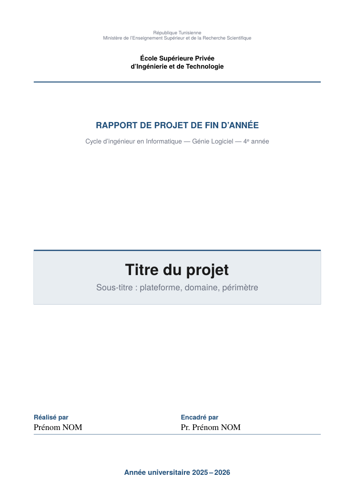

# PFA-Designer

An agent skill that writes a complete, beautifully typeset **rapport de PFA / PFE** (French, Tunisian engineering-school style) from the project sitting in your current folder.

It reads your repo, interviews you for what code cannot tell, picks the right chapter plan, draws diagrams from the real code, writes in a specific and honest voice, and builds a print-ready PDF with XeLaTeX.

<p align="center"></p>

## Why

Most PFA reports fail the same way: generic context, diagrams that do not match the code, clichés in the remerciements, invented numbers. Juries notice. This skill is built around the opposite rules:

- **Evidence first.** Every claim comes from the repo, the git history, or you. Unknown facts become `[À COMPLÉTER : …]` markers, never made-up metrics, supervisors or references.
- **School template wins.** It asks whether your school imposes a layout and adapts to it. Otherwise it uses defaults taken from real Tunisian guides.
- **Specific writing.** Each analysis paragraph must contain something only your project has: a module name, an endpoint, a commit range, a bug and its fix, a rejected alternative.
- **Original and cited.** Sources numbered, figures credited, reused code named, personal contribution separated from reused work.

## Research behind it

Structure and wording patterns come from about 9 real Tunisian PFE reports and 5 templates and guides (INSAT, ISI, ISI El Manar, EPMPT, ISIMed, ISET, ENSIT, ESPRIT template, ENET'Com, ENIT TIC, IT Business School, FSGF and ISEAHM guides, SupCom charter). Findings are in [`reference/structure.md`](skill/rapport-pfa-elite-designer/reference/structure.md).

Honest limits: no public ESPRIT PFA grid, no INSAT/ENIT margin rules and no real PFA report were found. PFA reports reuse the PFE skeleton, shorter. Always check your school's own rules.

## What you get

| Piece | What it does |
|---|---|
| `SKILL.md` | The workflow: recon → interview → chapter plan → scaffold → diagrams → write → build + QA → handoff |
| `reference/structure.md` | Front-to-back structure, page budgets, chapter plans for web, mobile, ML, IoT, network/DevOps, industrial, civil/mech |
| `reference/front-matter-fr.md` | Patterns for cover, dédicace, remerciements, résumé/abstract, introduction, conclusion |
| `reference/humanized-writing.md` | Voice rules, concrete-detail rule, cliché list, citation and originality rules |
| `reference/analysis-playbook.md` | What to extract from a repo and which chapter each fact goes in |
| `reference/design-system.md` | Margins, fonts, hierarchy, colours, callouts, French typography |
| `reference/diagrams.md` | Code → diagram mapping, TikZ starter, figure checklist |
| `reference/evaluation.md` | Jury grid, QA checklist, defense question prep |
| `template/` | XeLaTeX skeleton that compiles as-is: cover, front matter, 5 chapters, conclusion, biblatex, annexes |
| `scripts/analyze_repo.py` | Read-only repo fact extractor (stack, routes, models, tests, git timeline) → JSON |
| `scripts/build.sh` | `latexmk -xelatex` build with error summary (falls back to Tectonic) |
| `scripts/lint_report.py` | Placeholders, unreferenced figures, citations vs bibliography, clichés, repeated openers, flat rhythm, page budget |

## Install

The skill is a plain folder. Copy `skill/rapport-pfa-elite-designer/` into your agent's skills directory (`$SKILLS_DIR` below, see your agent's docs for its location).

```bash
git clone https://github.com/sinfoo/PFA-Designer.git
cp -r PFA-Designer/skill/rapport-pfa-elite-designer "$SKILLS_DIR"/
```

Requirements: a TeX distribution with XeLaTeX, `latexmk` and `biber` (MiKTeX or TeX Live) or [Tectonic](https://tectonic-typesetting.github.io/); Python 3.9+; optional `pymupdf` for page counts (`pip install pymupdf`). Fonts used are bundled with TeX Gyre.

## Use

Open your agent in the project folder and run:

```
/rapport-pfa-elite-designer
```

Or just ask for "le rapport PFA de ce projet". The agent will analyse the repo, ask one batch of questions (school, supervisors, real difficulties, imposed template, screenshots), then generate `rapport/` with `main.tex` and `main.pdf`.

Use the pieces on their own:

```bash
python skill/rapport-pfa-elite-designer/scripts/analyze_repo.py path/to/project > facts.json
cp -r skill/rapport-pfa-elite-designer/template rapport && cd rapport
# edit meta.tex (title, authors, school, year, accent colour), then:
bash ../skill/rapport-pfa-elite-designer/scripts/build.sh .
python ../skill/rapport-pfa-elite-designer/scripts/lint_report.py . --max-pages 60
```

## Defaults

A4 · margins 2.5 cm · Times-like 12 pt body (TeX Gyre Termes) · line spacing 1.5 · sans headings · one accent colour (change `\RAccent` in `meta.tex`) · header 10 pt with chapter title, footer with author and page · roman numerals for front matter, arabic from the introduction · IEEE numbered references · résumé FR + abstract EN with keywords.

## Responsible use

Many schools restrict AI assistance. Follow your school's rule and be ready to explain every page and every diagram at the defense. The skill deliberately includes no tricks to fool plagiarism or AI-detection tools; it aims for text that is genuinely grounded in your project and sources. Personal sections (dédicace, remerciements, difficulties) should come from your real experience.

## Contributing

Real report layouts, school-specific rules (margins, cover pages, grading grids) and new chapter plans are the most useful contributions. Open an issue or PR with the source of the rule.

## License

MIT
